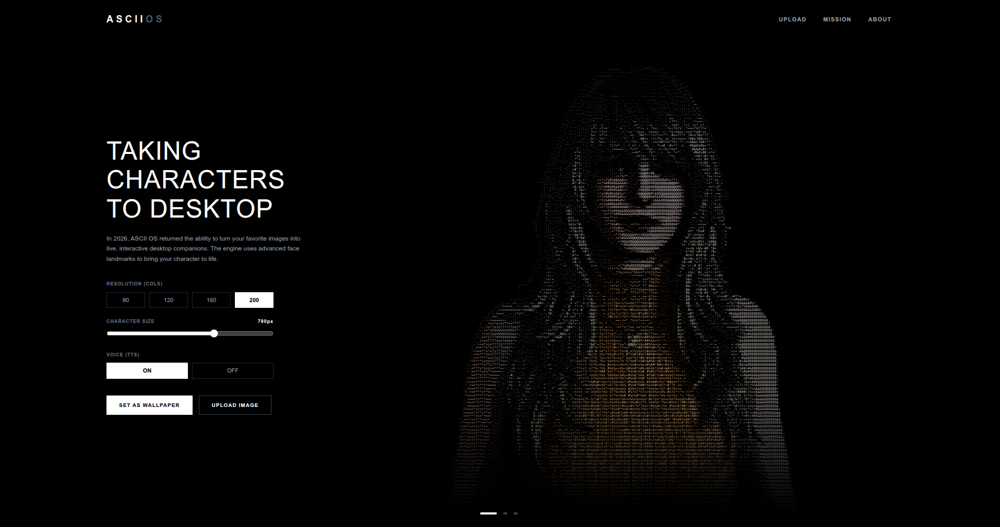
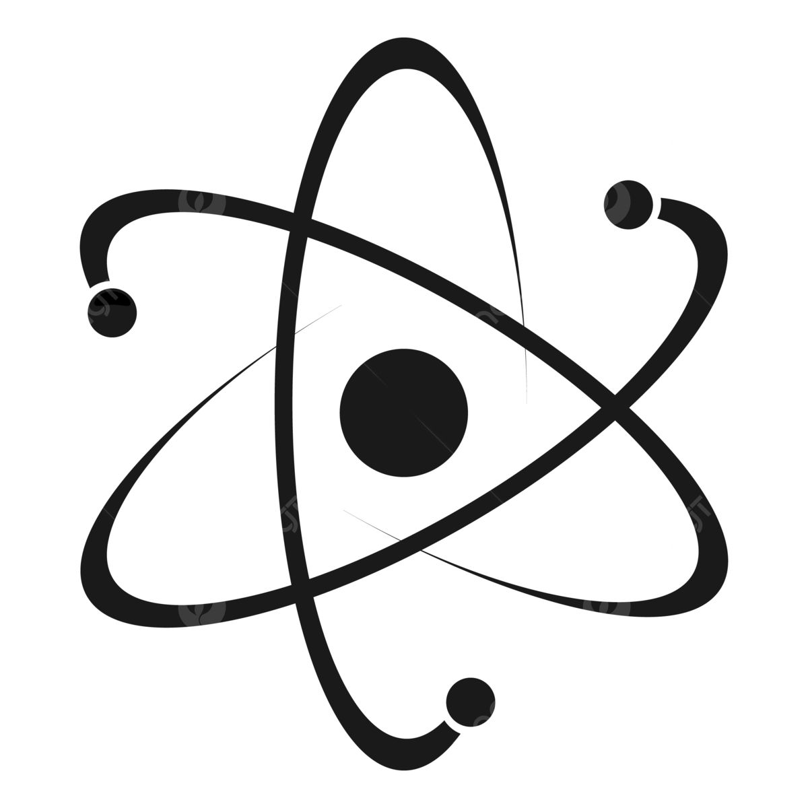

<!-- 1. BANNER UTAMA -->

  

<!-- 2. HEADER -->
<h1 align="center">ASCII OS</h1>
<h3 align="center">Live ASCII Wallpaper & Desktop Companion</h3>
<h4 align="center">> Bringing Desktops to Life</h4>

 

<!-- 3. ABOUT PROJECT (Tabel HTML Murni) -->
<h2 align="center">🚀 About The Project</h2>
<table align="center">
  <tr>
    <td valign="top" width="60%">
      
<b>ASCII OS</b> adalah aplikasi Desktop Environment eksperimental dan Live Wallpaper interaktif yang dibangun menggunakan Electron dan Next.js.

      
Aplikasi ini menampilkan karakter wajah ASCII yang beranimasi langsung di belakang ikon desktop Anda. Proyek ini menggunakan <b>MediaPipe</b> untuk mendeteksi gerakan wajah secara real-time, membuat karakter dapat berkedip dan bereaksi.

      
Dilengkapi dengan integrasi <b>Google Gemini API</b> dan <b>Text-to-Speech (TTS)</b>, Anda dapat mengobrol dengan desktop Anda sendiri.

      
Proyek ini dirancang khusus untuk sistem operasi Linux (X11) agar dapat menempel sempurna di lapisan paling bawah jendela aplikasi.

    </td>
    <td valign="top" width="40%" align="center">
      
    </td>
  </tr>
</table>

 

<!-- 4. CONNECT & LINKS -->
<h2 align="center">🔗 Connect & Links</h2>

  
  
  

 

<!-- 5. TECH STACK -->
<h2 align="center">🛠️ Tech Stack</h2>

  
    
  
  
  
  

 

<!-- 7. FOOTER -->

  

